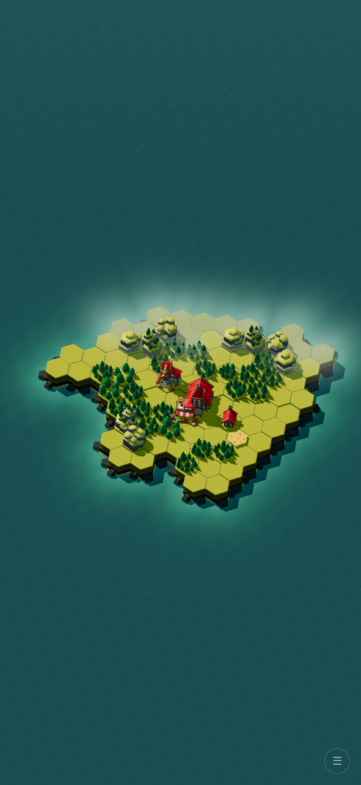

# Визуальное сравнение с референсом

Запрошенный мобильный кадр: production-сборка, Chromium с touch, 591×1280, DPR 1. Интерфейс находится в начальном свёрнутом состоянии. Это сохранённый результат визуального прохода для ревью.

Ориентир — референс острова, приложенный пользователем в переписке. Сравнение выполнено визуально по изображению, а не по успешности сборки.

| Критерий референса | Результат прохода |
| --- | --- |
| Широкая неровная суша, ступенчатые мысы | Асимметричный контур с западной бухтой и выступами на юге; ширина макета выросла с 20,9 до 27,4 единицы сцены при глубине 21,25. |
| Толстый край суши | Под травяной шапкой различимы грунт, светлая прослойка и тёмный скальный фундамент; у открытых граней — каменные выступы KayKit. |
| Глубокое бирюзовое море | Цвет меняется от мелководья у берега к тёмной воде; поверх градиента движутся слабая рябь и блики. |
| Поселение — центр композиции | Пять стартовых зданий собраны в компактную центральную группу; ратуша и красные крыши выделяются на фоне зелени. |
| Лес и горы образуют окружение | Западный лес, северо-восточный лес и южная группа; горы собраны в три гряды. Внутри групп меняются модели и ориентация. |
| Мягкая дымка на дальнем краю | Белые перекрывающиеся спрайты удалены. Один прозрачный слой с плавной маской не накапливает непрозрачность в местах пересечения клеток. |
| Тёплый свет и различимые материалы | Тёплый направленный свет, прохладная заполняющая подсветка, контраст травы, хвойного леса, камня и крыш. |
| Остров виден целиком | Ракурс более верхний; суша окружена водой, стартовые панели скрыты. |

По сравнению с исходным кадром заметно приблизились силуэт, группировка поселения, характер берега и прозрачность дымки. Остающиеся различия: точное расположение объектов, детализация зданий и индивидуальные формы моделей KayKit; мягкость атмосферной перспективы в референсе выше.

Формат клеток, типы DTO, загрузка данных и игровые механики сохранены. Изменены значения тестового макета и его отображение.

Проверка: `npm test` — 12 тестов; `npm run build` — успешная сборка. В браузере проверены загрузка шейдеров и моделей, свёрнутый интерфейс, тап, перенос, pinch, возврат камеры, ночь и изменение размера экрана. Физический телефон не использовался.
